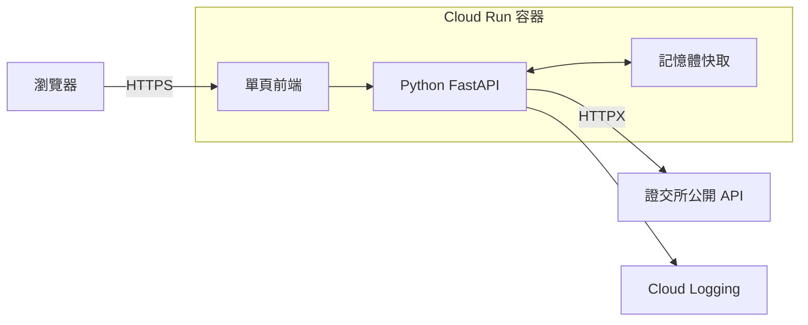
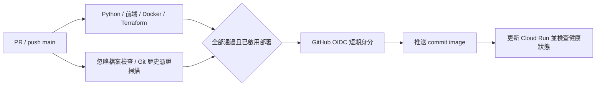
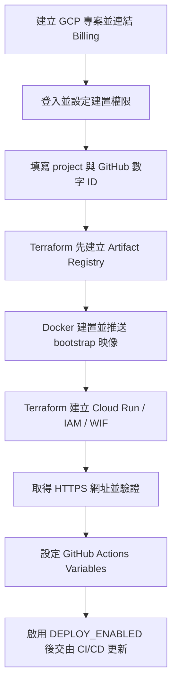

# 股日 Market Brief

台灣上市證券日行情查詢。Python FastAPI 串接證交所公開 API，提供公司搜尋、最新收盤行情、月度走勢、成交量／漲跌幅排行與瀏覽器關注清單。前後端共用一個 Docker 容器，部署目標為 Google Cloud Run。

[](https://github.com/cc-huang-0716/cathey_20261022/actions/workflows/deploy.yml)

## 不需要 GCP 的啟動方式

安裝 Git 與 Docker，Windows／macOS 先啟動 Docker Desktop，並使用 Linux containers。展示只需 Docker；Python、Node.js、GCP 帳號與 API 金鑰都不是啟動必要條件。首次建置需連網下載套件，金融資料查詢需能連上證交所。

```bash
git clone https://github.com/cc-huang-0716/cathey_20261022.git
cd cathey_20261022
docker build -t market-brief .
docker run -d --name market-brief -p 8080:8080 market-brief
```

網站：<http://localhost:8080> · Swagger：<http://localhost:8080/docs> · 健康檢查：<http://localhost:8080/health>

搜尋「台積電」或 `2330`，切換本月／上月走勢，再加入關注清單。查看日誌：`docker logs -f market-brief`；停止並移除容器：`docker rm -f market-brief`。重新展示時再執行上述 `docker run`。不需要 API 金鑰或資料庫。

網頁需透過上述 HTTP 網址開啟，讓前端請求由 FastAPI 提供 API。若 8080 已被占用，將 `-p 8080:8080` 改為 `-p 8081:8080`，再開啟 `http://localhost:8081`。若容器名稱已存在，先停止並移除自己的舊容器，或改用其他 `--name`。

可用 `docker inspect market-brief --format '{{.State.Health.Status}}'` 檢查狀態，正常為 `healthy`。健康檢查只驗證程式；來源網站異常時，行情區會顯示錯誤或有標示的快取資料。

重現驗證使用公開 GitHub clone 的 15 個追蹤檔案，在獨立目錄以 `docker build --no-cache --pull` 重新安裝並啟動，不掛載原工作目錄或憑證。GitHub Actions 另於全新 Ubuntu runner 安裝相依套件、執行 42 項 Python 與 4 項前端測試，並建置／啟動容器；結果可由上方 CI 連結檢查。

## 架構與服務選用



FastAPI 提供非同步資料查詢與 OpenAPI 文件；原生 HTML／CSS／JavaScript 無需前端建置。Cloud Run 直接執行容器並支援縮至零，Artifact Registry 儲存不可覆寫的版本映像，Cloud Logging 接收結構化日誌。記憶體快取減少來源請求，各執行個體獨立；目前功能不需要資料庫。

**行情為來源最新公布的日資料，非盤中即時報價。** 畫面標示實際交易日；價格與金額為新臺幣元，成交量為股，缺失值為 `null`。原始價格未經還原調整。最新行情快取 5 分鐘、本月歷史 15 分鐘、過去月份 24 小時；來源異常時，在快取期限後最多 1 小時提供有警告的先前資料。

## 測試與 CI/CD

Python 使用 3.12，前端測試使用 Node.js 24：

```powershell
python -m venv .venv
.venv\Scripts\python.exe -m pip install -r requirements-dev.lock
.venv\Scripts\python.exe -m pytest -q --asyncio-mode=auto test_app.py
.venv\Scripts\python.exe test_app.py --check
npm ci
npm run test:frontend
```

Linux/macOS 的 Python 路徑改為 `.venv/bin/python`。Python 共 42 項測試（資料處理／快取 15 項、API 27 項），前端有 4 項 DOM 操作測試；固定來源回應可隔離外部網路。DOM 測試不代替實際瀏覽器視覺檢查。

容器啟動後，可另跑 `.venv\Scripts\python.exe test_app.py --live`，驗證真實證交所行情、中文搜尋與月度資料。這項檢查依賴公開來源，不列為 CI 必要條件。

CI 也會對已啟動的容器執行 `Live TWSE integration`，將第三方資料連線結果另列於執行紀錄與 Summary。此步驟不阻擋 CI，檢查結果需另看該步驟的 `outcome`；公開來源異常不會被算成程式單元測試失敗。



協作採 GitHub Flow：功能分支 → PR → CI／Review → 合併 main。建議管理者設定 main 保護及至少一位 reviewer。流程為設計方案，未宣稱已完成多人審查。

## GCP 設定與建置流程

`main.tf` 管理 Artifact Registry、Cloud Run、執行／部署 service account、IAM 與 GitHub Workload Identity Federation。沒有 GCP 帳號時，可先用上面的 Docker 方式展示；以下提供日後實際建置的步驟。



### 1. 專案與登入

在 [GCP Console](https://console.cloud.google.com/) 建立或選擇專案，記下 **Project ID**，並連結 Billing。安裝 Google Cloud CLI、Terraform（1.6 以上且低於 2.0）與 Docker。首次建置的使用者需要啟用 API、建立映像倉庫／Cloud Run／service account／WIF 及設定 IAM 的權限；若為組織專案，請管理員授予對應權限。GitHub 的後續部署身分由 Terraform 另行建立。

以下命令中的 `YOUR_GCP_PROJECT_ID` 都須替換為自己的值：

```bash
gcloud auth login
gcloud config set project YOUR_GCP_PROJECT_ID
gcloud auth application-default login
gcloud services enable serviceusage.googleapis.com cloudresourcemanager.googleapis.com --project YOUR_GCP_PROJECT_ID
```

### 2. 填寫設定

在 repo 根目錄建立 `terraform.tfvars`，填入下列設定。此本機檔案已被 `.gitignore` 排除；金鑰、state 與計畫檔也不應上傳。

```hcl
project_id           = "YOUR_GCP_PROJECT_ID"
region               = "asia-east1"
container_image      = "asia-east1-docker.pkg.dev/YOUR_GCP_PROJECT_ID/market-brief/market-brief:bootstrap-1"
github_repository_id = "YOUR_NUMERIC_REPOSITORY_ID"
github_owner_id      = "YOUR_NUMERIC_OWNER_ID"
```

取得 GitHub ID：開啟 `https://api.github.com/repos/OWNER/REPO`，`id` 是 repository ID，`owner.id` 是 owner ID。這兩個值必須是數字；若 fork 或換 repo，務必使用自己的值。原始 repo 的值分別為 `1428349958`、`173608276`。WIF 僅信任指定 repo、owner 與 `main` 分支。

### 3. 建立映像倉庫並推送程式

先建立倉庫，避免 Cloud Run 建立時引用尚不存在的映像：

```bash
terraform init
terraform plan -target=google_artifact_registry_repository.images -out=bootstrap.tfplan
terraform apply bootstrap.tfplan
gcloud auth configure-docker asia-east1-docker.pkg.dev
docker build --platform linux/amd64 -t asia-east1-docker.pkg.dev/YOUR_GCP_PROJECT_ID/market-brief/market-brief:bootstrap-1 .
docker push asia-east1-docker.pkg.dev/YOUR_GCP_PROJECT_ID/market-brief/market-brief:bootstrap-1
```

映像名稱必須與 `container_image` 完全相同。倉庫禁止覆寫標籤；修改程式時使用新的標籤，例如 `bootstrap-2`。

### 4. 建立服務並驗證

```bash
terraform plan -out=deploy.tfplan
terraform apply deploy.tfplan
terraform output -raw service_url
```

開啟輸出的 HTTPS 網址，確認網站可載入，再檢查 `/health`、`/docs`、`/api/stocks/2330`。若組織政策不允許公開 `allUsers`，需請管理員核准此公開 Demo 的存取方式。

### 5. 啟用 CI/CD

執行 `terraform output github_actions_variables`，將輸出值填入該 GitHub repo 的 **Settings → Secrets and variables → Actions → Variables**：

| Variable | 內容 |
|---|---|
| `GCP_PROJECT_ID` | 自己的 GCP project ID |
| `GCP_REGION` | `asia-east1` |
| `GCP_AR_REPOSITORY` | `market-brief` |
| `CLOUD_RUN_SERVICE` | `market-brief` |
| `GCP_WORKLOAD_IDENTITY_PROVIDER` | Terraform 輸出的 WIF provider 名稱 |
| `GCP_DEPLOY_SERVICE_ACCOUNT` | Terraform 輸出的部署 service account email |
| `DEPLOY_ENABLED` | 完成上述驗證後才設為 `true` |

接著在 Actions 手動執行 workflow，或 push 至 `main`。所有必要檢查通過後，workflow 以 OIDC 取得短期身分，推送 commit 映像，再更新 Cloud Run。不需要上傳 service account JSON 金鑰。

Terraform 忽略後續 image 變動，避免覆蓋 CI 已發布版本。Demo 預設公開存取，Cloud Run 最小 0、最大 2 個執行個體。Terraform 使用本機 state；團隊使用前應設定共用 backend。容量限制與縮至零不代表整個專案保證免費。

**目前容器、測試與 CI 已驗證；尚未 apply 建立 GCP 資源或完成實際 CD。**

## 檔案用途

| 檔案 | 用途 |
|---|---|
| `app.py` | FastAPI、資料模型、證交所串接、快取與日誌 |
| `index.html` | 單頁前端，內含 CSS、JavaScript 與圖示 |
| `test_app.py` | 單元／API 測試、追蹤檔案檢查與真實來源驗證 |
| `test_frontend.mjs` | 前端搜尋、走勢、關注及非同步操作測試 |
| `requirements.lock`、`requirements-dev.lock` | 正式環境與測試用 Python 相依版本 |
| `package.json`、`package-lock.json` | 前端測試命令及相依版本 |
| `Dockerfile`、`.dockerignore` | 容器建置、非 root 執行與建置檔案篩選 |
| `main.tf`、`.terraform.lock.hcl` | GCP IaC 及 provider 版本鎖定 |
| `.github/workflows/deploy.yml` | CI/CD 工作流程 |
| `.gitignore` | 排除環境、憑證、state、工具與展示輸出 |

repo 共 15 個追蹤檔案。除 GitHub 規定的 `.github/workflows/` 外，其餘檔案都在第一層。README 是唯一說明文件；獨立簡報保留完整架構、流程及 AI 開發觀察。

AI 使用方式：以 Codex 協助將天氣規格改為金融查詢、實作資料轉換與測試、整理部署流程。開發觀察包括先實際呼叫公開 API 確認欄位、明確區分交易日及缺失值，以及以測試與部署證據確認結果。個人心得可在簡報中依實際經驗補充。

資料來源：[TWSE OpenAPI](https://openapi.twse.com.tw/)、[個股日成交資訊](https://www.twse.com.tw/zh/trading/historical/stock-day.html)。部署參考：[Cloud Run 容器規範](https://docs.cloud.google.com/run/docs/container-contract)、[Cloud Run 建置前置作業](https://docs.cloud.google.com/run/docs/quickstarts/deploy-container)、[Terraform 登入方式](https://docs.cloud.google.com/docs/terraform/authentication)、[WIF 設定與數字 ID](https://docs.cloud.google.com/iam/docs/workload-identity-federation-with-deployment-pipelines)、[Google GitHub Actions Auth](https://github.com/google-github-actions/auth)。
