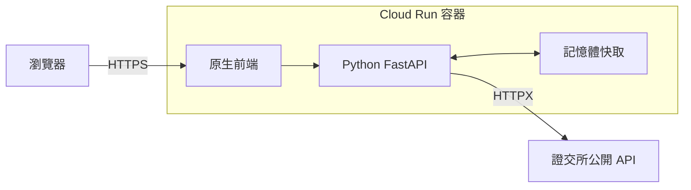

# 股日 Market Brief

台灣上市證券日行情查詢。Python FastAPI 串接證交所公開 API，原生 HTML / CSS / JavaScript 前端與後端共用一個 Docker 容器，部署目標為 Google Cloud Run。

[](https://github.com/cc-huang-0716/cathey_20261022/actions/workflows/deploy.yml)

## 啟動

先啟動 Docker Desktop，再於專案根目錄執行：

```bash
docker compose up --build -d
```

網站：<http://localhost:8080> · API 文件：<http://localhost:8080/docs> · 健康檢查：<http://localhost:8080/health>

查看日誌：`docker compose logs -f`；停止：`docker compose down`。不需要 API 金鑰或資料庫。

## 功能與架構

支援公司名稱／代號搜尋、最新收盤行情、月度歷史走勢、成交量／漲跌幅排行，以及儲存在瀏覽器的關注清單。



**資料為來源最新公布的日行情，非盤中即時報價。** 畫面標示實際交易日；價格及金額為新臺幣元，成交量為股，缺失值為 `null`。原始收盤價未經還原調整。

最新行情快取 5 分鐘，本月歷史 15 分鐘，過去月份 24 小時。來源失敗時，可在快取期限後最多 1 小時顯示有警告的先前資料；各個執行個體不共享快取。

## 測試與 CI

Python 使用 3.12，前端測試使用 Node.js 24。以下在已安裝對應工具的環境執行：

```powershell
python -m venv .venv
.venv\Scripts\python.exe -m pip install -r requirements-dev.lock
.venv\Scripts\python.exe -m pytest -q
npm ci
npm run test:frontend
```

Linux/macOS 將 Python 路徑改為 `.venv/bin/python`。

- `tests/test_cache_and_parsing.py`：15 項單元／服務測試。
- `tests/test_api.py`：27 項 API 測試，以固定來源回應隔離外部網路。
- `tests/frontend.test.mjs`：4 項 DOM 操作測試。
- 服務啟動後，可另跑 `python scripts/smoke_test.py` 驗證真實證交所資料。

PR、push main 或手動執行 Actions，會檢查誤追蹤檔案、掃描 Git 歷史憑證、執行測試、建置／檢查容器，以及驗證 Terraform。任一必要檢查失敗就不部署。依賴版本固定在各個 lock 檔。

## 雲端部署

`terraform/` 管理 Artifact Registry、Cloud Run、service account、IAM 與 GitHub Workload Identity Federation。首次部署需要已啟用 Billing 的 GCP 專案及可用的 bootstrap 身分：

1. 登入 `gcloud auth login` 及 `gcloud auth application-default login`。
2. 複製 `terraform/terraform.tfvars.example` 為 `terraform/terraform.tfvars`，填入 project ID 與 bootstrap image。實際變數檔已忽略。
3. 執行 `terraform -chdir=terraform init`，首次先以 `-target=google_artifact_registry_repository.images` 的 plan / apply 建立映像倉庫。
4. 使用 `gcloud auth configure-docker REGION-docker.pkg.dev` 登入倉庫，建置並推送 template 中對應的 Linux amd64 image。
5. 執行完整 Terraform plan / apply，再用 `terraform -chdir=terraform output github_actions_variables` 取得 GitHub Actions Variables。
6. 在儲存庫設定輸出的 Variables，最後才開啟 `DEPLOY_ENABLED=true`。

main 驗證通過後，Actions 使用短期 OIDC 身分推送不可覆寫的 commit image，更新既有 Cloud Run，再檢查 `/health` 與 OpenAPI。Terraform 忽略後續 image 變動，避免覆蓋 CI 發布的版本。

**目前本機容器、測試與 CI 已通過，尚未 apply 建立 GCP 資源或完成實際 CD。** Cloud Run 預設允許公開 Demo；容量上限與縮至零設定不代表整個專案保證免費。

## 原始碼與展示資料

| 目錄 | 責任 |
|---|---|
| `app/` | FastAPI、第三方資料轉換、快取與原生前端 |
| `tests/` | 單元、API 及前端測試 |
| `.github/workflows/` | CI/CD |
| `terraform/` | GCP 基礎設施與 IAM |
| `scripts/` | 上傳檔案檢查與真實資料驗證 |

完整架構圖、CI/CD 與 Git 流程、服務選用原因及 AI 開發說明，以獨立展示簡報交付。repo 保留執行與維護所需來源；本機說明、簡報、打包工具及輸出產物不納入追蹤。

資料來源：[TWSE OpenAPI](https://openapi.twse.com.tw/)、[個股日成交資訊](https://www.twse.com.tw/zh/trading/historical/stock-day.html)。部署參考：[Cloud Run 容器規範](https://docs.cloud.google.com/run/docs/container-contract)、[Google GitHub Actions Auth](https://github.com/google-github-actions/auth)。
