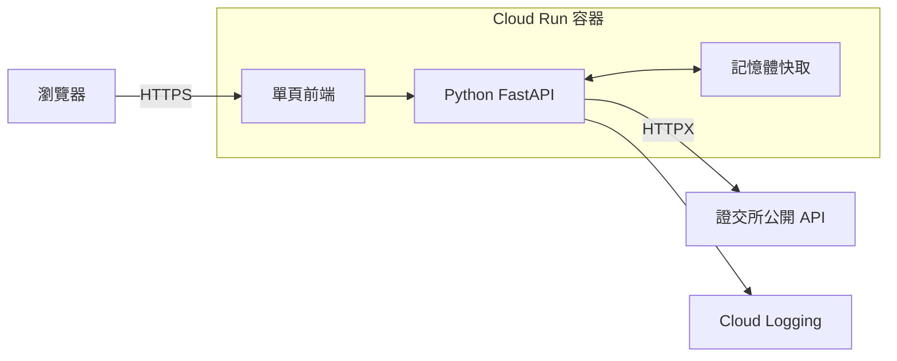
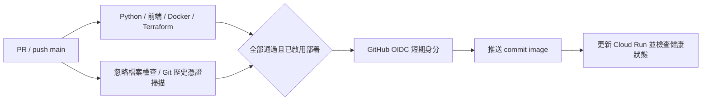

# 股日 Market Brief

台灣上市證券日行情查詢。Python FastAPI 串接證交所公開 API，提供公司搜尋、最新收盤行情、月度走勢、成交量／漲跌幅排行與瀏覽器關注清單。前後端共用一個 Docker 容器，部署目標為 Google Cloud Run。

[](https://github.com/cc-huang-0716/cathey_20261022/actions/workflows/deploy.yml)

## 啟動展示

先啟動 Docker Desktop，再於專案根目錄執行：

```bash
docker build -t market-brief .
docker run -d --name market-brief -p 8080:8080 market-brief
```

網站：<http://localhost:8080> · Swagger：<http://localhost:8080/docs> · 健康檢查：<http://localhost:8080/health>

搜尋「台積電」或 `2330`，切換本月／上月走勢，再加入關注清單。查看日誌：`docker logs -f market-brief`；停止並移除容器：`docker rm -f market-brief`。重新展示時再執行上述 `docker run`。不需要 API 金鑰或資料庫。

## 架構與服務選用



FastAPI 提供非同步資料查詢與 OpenAPI 文件；原生 HTML／CSS／JavaScript 無需前端建置。Cloud Run 直接執行容器並支援縮至零，Artifact Registry 儲存不可覆寫的版本映像，Cloud Logging 接收結構化日誌。記憶體快取減少來源請求，各執行個體獨立；目前功能不需要資料庫。

**行情為來源最新公布的日資料，非盤中即時報價。** 畫面標示實際交易日；價格與金額為新臺幣元，成交量為股，缺失值為 `null`。原始價格未經還原調整。最新行情快取 5 分鐘、本月歷史 15 分鐘、過去月份 24 小時；來源異常時，在快取期限後最多 1 小時提供有警告的先前資料。

## 測試與 CI/CD

Python 使用 3.12，前端測試使用 Node.js 24：

```powershell
python -m venv .venv
.venv\Scripts\python.exe -m pip install -r requirements-dev.lock
.venv\Scripts\python.exe -m pytest -q --asyncio-mode=auto test_app.py
.venv\Scripts\python.exe test_app.py --check
npm ci
npm run test:frontend
```

Linux/macOS 的 Python 路徑改為 `.venv/bin/python`。Python 共 42 項測試（資料處理／快取 15 項、API 27 項），前端有 4 項 DOM 操作測試；固定來源回應可隔離外部網路。DOM 測試不代替實際瀏覽器視覺檢查。

容器啟動後，可另跑 `.venv\Scripts\python.exe test_app.py --live`，驗證真實證交所行情、中文搜尋與月度資料。這項檢查依賴公開來源，不列為 CI 必要條件。



協作採 GitHub Flow：功能分支 → PR → CI／Review → 合併 main。建議管理者設定 main 保護及至少一位 reviewer。流程為設計方案，未宣稱已完成多人審查。

## 雲端建置

`main.tf` 管理 Artifact Registry、Cloud Run、執行／部署 service account、IAM 與 GitHub Workload Identity Federation。首次建置需要已啟用 Billing 的 GCP 專案及有建置權限的身分：

1. 執行 `gcloud auth login` 及 `gcloud auth application-default login`。
2. 在根目錄建立 `terraform.tfvars`，填入下列設定；此本機設定檔已忽略。
3. 執行 `terraform init`，再執行 `terraform plan -target=google_artifact_registry_repository.images -out=bootstrap.tfplan` 及 `terraform apply bootstrap.tfplan`。
4. 執行 `gcloud auth configure-docker asia-east1-docker.pkg.dev`；使用下列 `container_image` 值作為 `IMAGE`，以 `docker build --platform linux/amd64 -t IMAGE .` 建置，再 `docker push IMAGE`。
5. 執行完整的 `terraform plan -out=deploy.tfplan` 及 `terraform apply deploy.tfplan`。
6. 執行 `terraform output github_actions_variables`，將輸出值填入 GitHub Actions Variables；最後才開啟 `DEPLOY_ENABLED=true`。

```hcl
project_id           = "YOUR_GCP_PROJECT_ID"
region               = "asia-east1"
container_image      = "asia-east1-docker.pkg.dev/YOUR_GCP_PROJECT_ID/market-brief/market-brief:bootstrap-1"
github_repository_id = "1428349958"
github_owner_id      = "173608276"
```

後續由 CI 發布 commit 映像；Terraform 忽略後續 image 變動，避免覆蓋已發布版本。Demo 預設公開存取，Cloud Run 最小 0、最大 2 個執行個體。Terraform 使用本機 state；團隊使用前應設定共用 backend。容量限制與縮至零不代表整個專案保證免費。

**目前容器、測試與 CI 已驗證；尚未 apply 建立 GCP 資源或完成實際 CD。**

## 檔案用途

| 檔案 | 用途 |
|---|---|
| `app.py` | FastAPI、資料模型、證交所串接、快取與日誌 |
| `index.html` | 單頁前端，內含 CSS、JavaScript 與圖示 |
| `test_app.py` | 單元／API 測試、追蹤檔案檢查與真實來源驗證 |
| `test_frontend.mjs` | 前端搜尋、走勢、關注及非同步操作測試 |
| `requirements.lock`、`requirements-dev.lock` | 正式環境與測試用 Python 相依版本 |
| `package.json`、`package-lock.json` | 前端測試命令及相依版本 |
| `Dockerfile`、`.dockerignore` | 容器建置、非 root 執行與建置檔案篩選 |
| `main.tf`、`.terraform.lock.hcl` | GCP IaC 及 provider 版本鎖定 |
| `.github/workflows/deploy.yml` | CI/CD 工作流程 |
| `.gitignore` | 排除環境、憑證、state、工具與展示輸出 |

repo 共 15 個追蹤檔案。除 GitHub 規定的 `.github/workflows/` 外，其餘檔案都在第一層。README 是唯一說明文件；獨立簡報保留完整架構、流程及 AI 開發觀察。

AI 使用方式：以 Codex 協助將天氣規格改為金融查詢、實作資料轉換與測試、整理部署流程。開發觀察包括先實際呼叫公開 API 確認欄位、明確區分交易日及缺失值，以及以測試與部署證據確認結果。個人心得可在簡報中依實際經驗補充。

資料來源：[TWSE OpenAPI](https://openapi.twse.com.tw/)、[個股日成交資訊](https://www.twse.com.tw/zh/trading/historical/stock-day.html)。部署參考：[Cloud Run 容器規範](https://docs.cloud.google.com/run/docs/container-contract)、[Google GitHub Actions Auth](https://github.com/google-github-actions/auth)。
