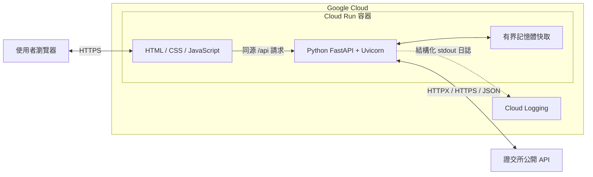
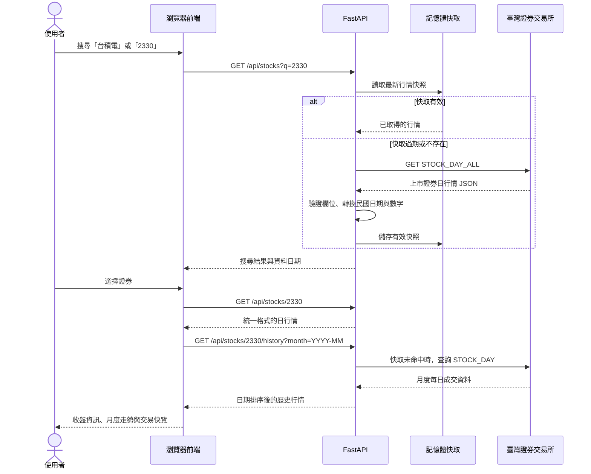
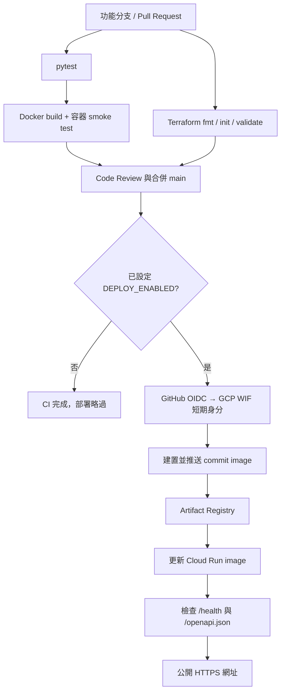

# 架構與流程圖

## 系統運行架構

前端與 API 共用來源，因此不需要另開 CORS。Cloud Run 提供 HTTPS 與執行個體擴縮；容器只監聽 HTTP `0.0.0.0:$PORT`。執行身分不持有專案角色，僅需要存取網際網路上的公開資料。Cloud Logging 收集 stdout 的 JSON 日誌。

記憶體快取不構成持久儲存：執行個體重啟就會清空，不同個體之間不共享快取。這個取捨適合小型 Demo；若流量放大，應改為排程匯入與共享儲存，避免每個個體重複向來源擷取。

## 單檔行情執行流程

來源失敗時，若快取仍在容許的舊資料期限內，回傳 `stale=true` 與提示；否則回傳 502／503／504。相同個體內的同時更新會合併成一個來源請求，失敗後退避 30 秒。

## CI/CD 部署架構

WIF 同時比對 GitHub repository ID、owner ID 及 `refs/heads/main`；Pull Request 測試不取得部署身分。部署者僅具備對指定映像倉庫的寫入權、Cloud Run developer 權限及使用 runtime service account 的權限。

Terraform 建立資源及 IAM，GitHub Actions 更新映像版本。回滾使用已存在的 commit tag／digest，參考 [部署說明](deployment.md)。
