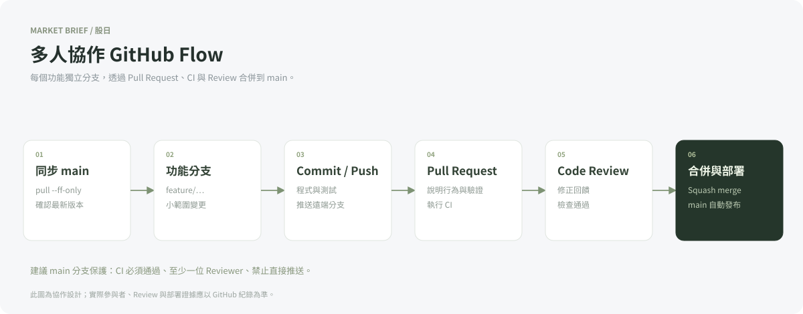
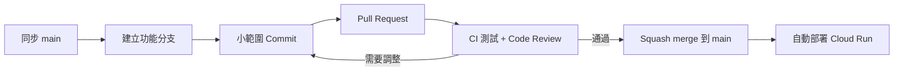

# 多人協作 Git 工作流程





## 建議分工

| 成員 | 責任 |
|---|---|
| A | FastAPI、資料清理、來源錯誤與測試 |
| B | 前端、圖表、搜尋及可用性 |
| C（若有） | Docker、Terraform、CI/CD 與文件 |

每個功能分支仍須包含對應驗證；分工不代表跳過其他成員的 review。

## 操作範例

```bash
git switch main
git pull --ff-only
git switch -c feature/stock-history
# 修改程式與相關測試
git add app tests
git commit -m "Add monthly stock history lookup"
git push -u origin feature/stock-history
```

在 GitHub 建立 PR，說明變更目的、驗證方式與部署影響。建議設定 main 分支保護：要求 CI 通過、至少一位 reviewer、禁止直接 push。專案已提供 PR 範本；分支保護需要由儲存庫擁有者設定。

CI 紅燈時持續推送到同一功能分支；review 通過後 squash merge。合併後保留可追溯的 PR 與 commit image tag。發生問題時，用已知良好的 image tag 回滾，另開修復 PR。

本文件描述可執行的協作方式，未虛構多人參與、review 或部署紀錄。
