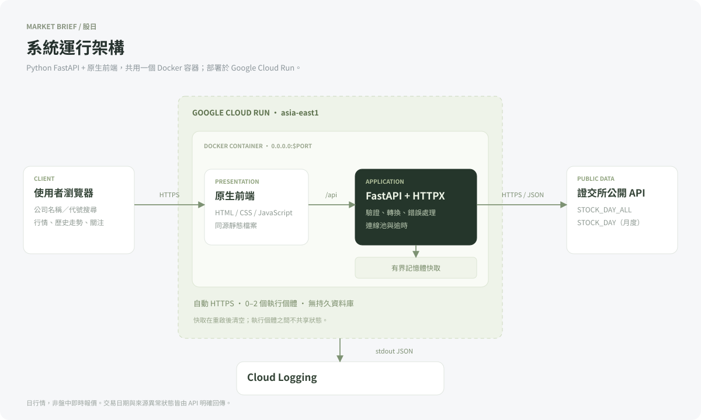
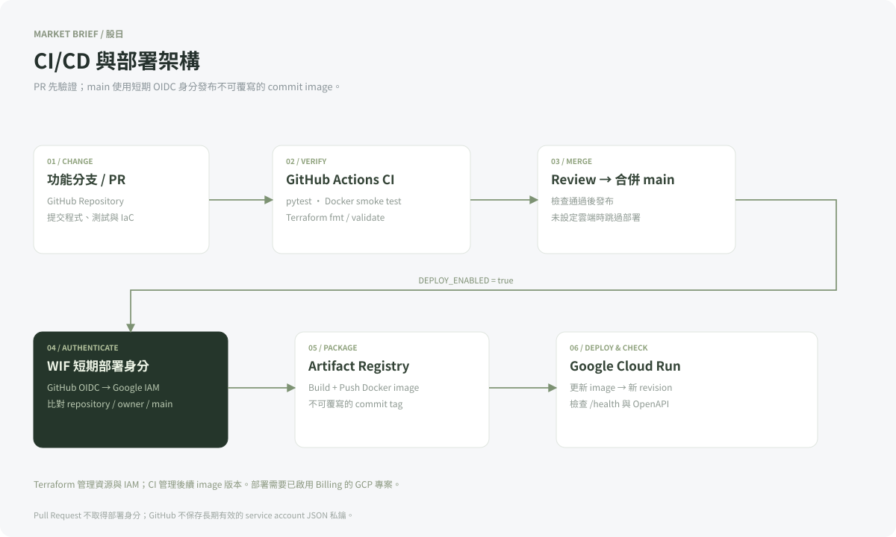

# 股日 Market Brief｜雲端後端實作

## 一、程式用途與應用情境

本系統提供台灣上市股票及 ETF 的每日行情查詢。使用者輸入公司名稱或證券代號，即可查看來源最近公布的收盤價、漲跌幅、開高低價、成交量與單月歷史走勢，並可將關注證券儲存在目前瀏覽器。

系統採用證交所已公開的日成交資料，不要求券商帳戶或 API 金鑰。這些資料不是盤中即時報價；當日行情尚未公布、休市或來源延遲時，會保留並標示實際交易日期。

## 二、主要功能

| 功能 | 實作 |
|---|---|
| 公司／代號搜尋 | 支援中文名稱、部分名稱及證券代號，處理全形數字 |
| 最新日行情 | 收盤、漲跌、漲跌幅、開盤、最高、最低、成交股數、金額與筆數 |
| 歷史走勢 | 依月份查詢最近 12 個月中的每日成交資料；前端提供本月與上月 |
| 市場概況 | 上漲、下跌、持平、無有效漲跌資料家數與總成交金額 |
| 市場排行 | 成交量、漲幅與跌幅前十名 |
| 我的關注 | localStorage 儲存最多 20 檔，不含登入及雲端同步 |
| API 文件 | FastAPI 自動產生 `/docs` 與 `/openapi.json` |
| 健康檢查與日誌 | `/health` 與具有 request ID 的 JSON stdout 日誌 |

## 三、雲端服務選用原因

| 層級 | 技術／服務 | 選用原因 |
|---|---|---|
| 前端 | HTML / CSS / JavaScript | 無額外前端框架或 CDN，降低建置及部署複雜度 |
| 後端 | Python FastAPI | 明確的資料模型、輸入驗證、非同步處理與 OpenAPI |
| HTTP Client | HTTPX AsyncClient | 重用連線池，明確設定連線／請求逾時 |
| 容器 | Docker | 本機與正式環境使用相同依賴，非 root 身分執行 |
| 雲端運算 | Google Cloud Run | 執行容器、自動管理 HTTPS、支援縮至零與設定擴縮上限 |
| 映像儲存 | Artifact Registry | 儲存按 commit 標記且不可覆寫的應用映像 |
| 監控 | Cloud Logging | 收集 JSON stdout，依 request ID、路徑、狀態查詢問題 |
| 身分 | IAM / WIF | 將 runtime 與 deployer 分離，GitHub 使用短期 OIDC 身分 |
| IaC | Terraform | 以程式碼管理資源及 IAM，可檢查差異與重建 |
| CI/CD | GitHub Actions | PR 自動驗證；main 驗證通過後發布新版本 |

Cloud Run 設定為每個個體 1 vCPU、512 MiB、最多 2 個執行個體，最小個體數 0。這是 Demo 容量設定，不是壓力測試後的容量保證。[Cloud Run 容器規範](https://docs.cloud.google.com/run/docs/container-contract)

## 四、系統架構圖

前後端共用一個 Cloud Run 服務。FastAPI 將外部資料轉成統一模型，再回傳前端；前端不直接存取證交所。系統不保存使用者帳戶或歷史資料，因此不建立持久資料庫。

最新快照及歷史查詢使用有界記憶體快取，降低外部請求次數。快取於冷啟動後重新取得，不同執行個體之間獨立。若未來需要跨個體共享資料、長期留存或大量查詢，可改為 Cloud Scheduler 定期擷取，並加入資料庫或物件儲存。

完整 API 序列圖見 [架構與流程圖](architecture.md)。

## 五、資料與錯誤處理

資料來源為 [臺灣證券交易所 OpenAPI](https://openapi.twse.com.tw/) 的 `STOCK_DAY_ALL`，以及 [個股日成交資訊](https://www.twse.com.tw/zh/trading/historical/stock-day.html) 的 `STOCK_DAY` JSON 端點。

- 民國日期轉為 ISO 西元日期，所有月份判定使用 Asia/Taipei。
- 移除數字千分位；無有效成交價格或非數值欄位回傳 `null`。
- 金額使用新臺幣元；成交量使用股，不將股數錯當成張。
- 漲跌幅依來源漲跌價差反推參考價，以 Decimal 計算；原始價格未經還原。
- 不混合不同交易日的資料計算當日市場統計。
- 參數錯誤回傳 422，查無證券回傳 404，來源異常回傳 502／503／504。
- 來源失敗時若使用先前資料，回傳明確 `stale`、警告及原取得時間。
- `/health` 不依賴第三方回應，避免來源維護導致容器不必要重啟。

## 六、CI/CD 與多人協作

Pull Request 執行 pytest、Docker 建置與 smoke test，以及 Terraform validate。main 通過驗證且已設定部署變數後，以 WIF 取得短期身分，將 image 推至 Artifact Registry，再發布至既有 Cloud Run 服務。流程以 `/health` 與 OpenAPI 驗證部署，避免把外部資料源的短暫維護視為應用部署失敗。

多人協作使用 GitHub Flow：功能分支 → Commit → Pull Request → CI 與 Review → 合併 main → 自動部署。流程與建議分工見 [Git 工作流程](git-workflow.md)。本專案提供流程設計，不宣稱已實際進行雙帳號 Review。

## 七、IaC、AI 輔助與繳交範圍

Terraform 管理啟用 API、Artifact Registry、Cloud Run、service account 與 WIF。首次部署及 GitHub 變數設定見 [部署說明](deployment.md)。應用映像的後續版本由 CI 管理，Terraform 忽略該欄位，避免覆蓋已發布版本。

開發過程使用 Codex 協助架構轉換、程式撰寫、產生測試、容器化與 Terraform 設定；透過真實來源回應、pytest、容器 smoke test 及 Terraform validate 驗證結果。使用方式及開發觀察見 [AI 輔助開發](ai-development.md)。

| 題目項目 | 對應成果 |
|---|---|
| Python 雲端後端 | FastAPI 程式、Dockerfile、Cloud Run Terraform 設定 |
| 雲端架構圖 | Runtime SVG、CI/CD SVG、Mermaid 序列圖 |
| 加分 1：前端 | 可搜尋、看行情與歷史走勢的網頁 |
| 加分 2：第三方 REST API | 證交所最新行情與歷史成交資訊 |
| 加分 3：CI/CD | GitHub Actions YAML 與流程圖 |
| 加分 4：Git 協作 | GitHub Flow 圖、PR 範本與協作說明 |
| 加分 5：IaC | Terraform 資源與 IAM 定義 |
| 加分 6：AI 輔助 | 使用方式、驗證方法與開發觀察 |

實際完成的驗證與尚待提供的雲端環境資訊，以 [驗證紀錄](verification.md) 為準。本機容器可執行；沒有 GCP 專案與部署授權身分前，不能視為完成公開 HTTPS 上雲或 CI/CD 實際執行證明。
